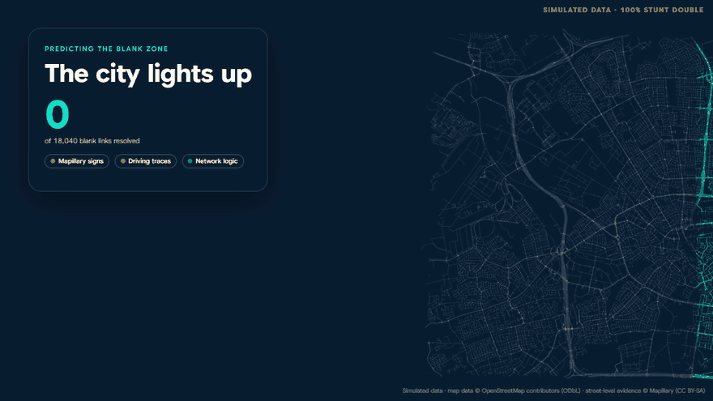
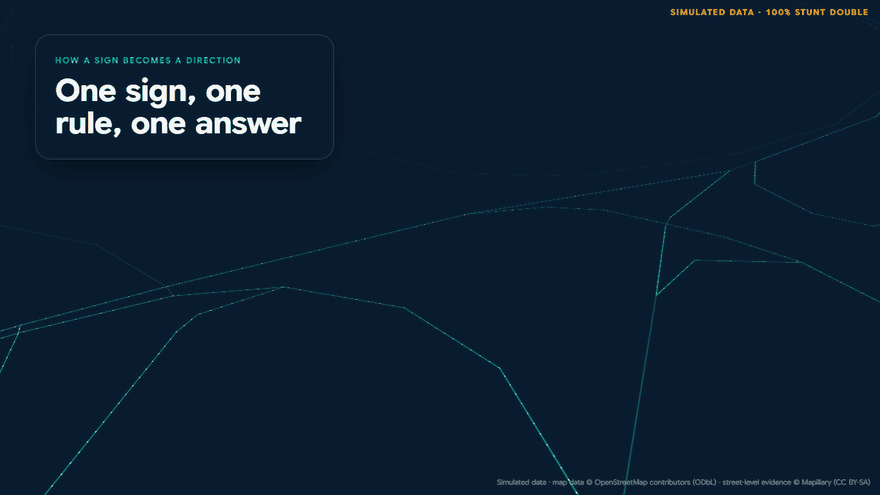
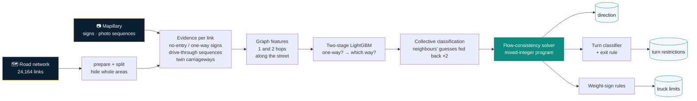
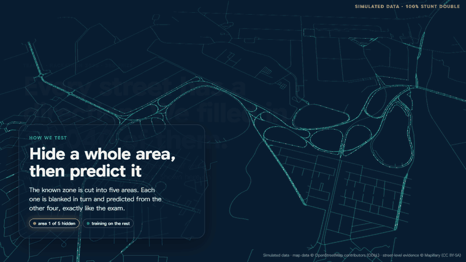
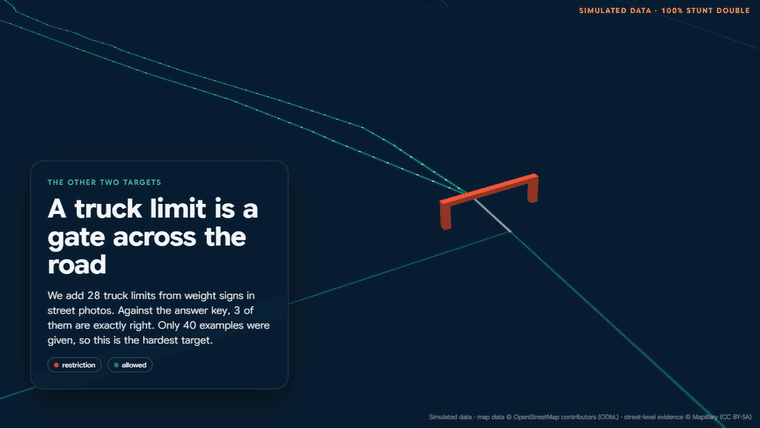

<p align="center">
  
</p>

<p align="center">
  <a href="#-beat-our-score"></a>
  <a href="https://danushkumar-v.github.io/one-way-or-another/"></a>
  
</p>
<p align="center">
  
  
  
  
  
</p>

<p align="center">
  <b><a href="https://danushkumar-v.github.io/one-way-or-another/">▶ Open the live deck</a></b> &nbsp;·&nbsp;
  <a href="#-run-it-in-two-minutes">Run it in two minutes</a> &nbsp;·&nbsp;
  <a href="#-how-it-works">How it works</a> &nbsp;·&nbsp;
  <a href="#-beat-our-score">Beat our score</a>
</p>

---

Take a city's road map and **erase which way three quarters of its streets go**. One-way or two-way? Which turns are banned? Where can't a truck fit? The job: fill it all back in, using only the shape of the network and what street-level photos can see.

We built the first version in a day at a hackathon as Team A, and it took **third prize**. 🥉 This repo is the public remake: same ideas, same code, a brand-new city.

> [!CAUTION]
> ### 🎭 Every byte of data in this repo is a stunt double.
> The city, the blanks, the answer key, even the file format: all **simulated**. We built it from open map data, blanked it ourselves and scored it ourselves. Nothing we were handed at the event is in here. Not in the files, not in the commit history, not hiding in a GIF frame. We checked. Twice. With a magnifying glass. 🔎
>
> If a street looks familiar, that's because open map data is, well, open. Every number below was measured on the stunt double, so you can reproduce every one of them on your own laptop. Our lawyers would be proud, if we had any.

<p align="center">
  
  <br><sub><b>The city lights up.</b> 18,040 blank links resolved in three waves: street signs, then driving traces from photo sequences, then pure network logic.</sub>
</p>

## 🧩 The puzzle

<table>
<tr>
<td width="25%" valign="top"><b>1 · Direction of travel</b><br><sub>18,040 blank links</sub><br><br>Each link gets <code>F</code>, <code>T</code> or <code>B</code>: one-way from <code>node_a</code> (its southern end) to <code>node_b</code>, one-way back towards <code>node_a</code>, or both ways.</td>
<td width="25%" valign="top"><b>2 · Turn restrictions</b><br><sub>ordered link lists</sub><br><br>The link you come <b>from</b> first, then the link you may not enter. A single link means "no U-turn".</td>
<td width="25%" valign="top"><b>3 · Truck limit type</b><br><sub>which link</sub><br><br>Which links carry a <code>HEIGHT</code>, <code>WEIGHT</code> or <code>NO TRUCKS</code> restriction.</td>
<td width="25%" valign="top"><b>4 · Truck limit value</b><br><sub>cm / kg</sub><br><br>The number on the sign: height in centimetres, weight in kilograms.</td>
</tr>
</table>

Direction comes first, because everything else depends on it: a turn only needs banning if it's legal in the first place, and a sign only governs the road it faces.

| | Links | One-way share | Given turn restrictions | Given truck limits |
|---|---:|---:|---:|---:|
| **Known zone** (east) | 6,124 | 30% | 75 | 40 |
| **Blank zone** (west) | 18,040 | **?** | **?** | **?** |

Street-level evidence comes from **Mapillary**: 53,278 traffic-sign detections, 498,300 point features and 2.3 million photo positions with compass headings.

## 🔍 How it works

<p align="center">
  
  <br><sub><b>One sign, one rule, one answer.</b> A no-entry sign seen in 557 photos is snapped to the link it faces. "No entry at the southern end" means traffic flows towards it, so the answer is <code>T</code>.</sub>
</p>



<details>
<summary><b>The pieces, in plain words</b> (click)</summary>
<br>

| Step | What it does | Why it matters |
|---|---|---|
| **Sign facing** | Every Mapillary sign was seen by several cameras. Their compass headings tell us which way the sign faces, so it is matched to the link it actually governs, not the cross street. | A sign is useless if you pin it to the wrong road. |
| **Drive-through sequences** | Consecutive photos in a sequence give a direction of motion. If cars only ever film a street going one way, that's evidence. Walkers and cyclists are filtered out by speed. | Covers streets without a single sign. |
| **Twin carriageways** | Two parallel one-way links with the same name: traffic keeps right, so the opposite carriageway is on the left. | Dual roads are everywhere and the signs are often far away. |
| **Graph features** | Evidence is pushed 1 and 2 hops along the street (same name, near-straight continuation), re-expressed in each link's own frame. | Streets don't change direction at every junction. |
| **Two-stage LightGBM** | Stage 1: is it one-way? (orientation-free features). Stage 2: which way? (oriented differences, trained on mirrored copies so F and T are symmetric). | Road class tells you *that* a street is one-way, never *which way*. |
| **Collective classification** | Neighbours' predicted one-way probability and direction become features for two more rounds. | Lets a confident street convince its uncertain neighbours. |
| **Flow-consistency solver** | A mixed-integer program over the model's probabilities. Soft penalties: every junction needs a way in and a way out, twin carriageways run opposite, direction carries through 2-link nodes. Solves 20k links in under a second. | Fixes physically impossible maps: no junction may be a black hole. |
| **Turn classifier** | One row per possible turn at every junction (angle, road classes, one-ways, signs, painted lane arrows, traffic lights), learned from the given restrictions. **Exit rule:** a ban may never remove the last legal exit. | Many banned turns have no sign at all. |
| **Truck rules** | A weight-limit sign governs the link it faces. The value is the most common one among the given rows. | Too few examples to learn from, so rules beat models. |

</details>

## 📈 Step by step

Every idea had to earn its place. Each row trains on the known zone, predicts **the whole blank zone**, and is scored against the answer key:

| Step | Direction accuracy |
|---|---:|
| Everything two-way | 67.6% `█████████████▌      ` |
| Link attributes only (road class, length, shape) | 78.4% `███████████████▋    ` |
| \+ Mapillary signs, drive-through sequences, twin carriageways | 90.9% `██████████████████▏ ` |
| \+ graph features, 1 and 2 hops along the street | 91.7% `██████████████████▎ ` |
| \+ collective classification, 2 rounds | 92.2% `██████████████████▍ ` |
| **\+ flow-consistency solver (final)** | **92.7%** `██████████████████▌ ` |

When the final model calls a street one-way it is right 96% of the time. When it finds a one-way street, it picks the right direction 96% of the time. What it still misses is quiet one-way streets with no sign and no camera.

<p align="center">
  
  
  <br><sub><b>Left:</b> no random splits. Whole areas are hidden and predicted, exactly like the exam. &nbsp; <b>Right:</b> a turn restriction is a blocked arc; the other exits stay open.</sub>
</p>

**Honest corner.** Turn restrictions and truck limits are much harder than directions. On this city, 10 of our 40 new turn restrictions match the answer key exactly (F1 0.09), and 3 of 28 truck limits (F1 0.06). Reading ban signs directly matches almost nothing, because most restrictions on a map have no sign on the street. If you can do better here, please do. See below.

## 🚀 Run it in two minutes

```bash
git clone https://github.com/danushkumar-v/one-way-or-another.git
cd one-way-or-another
pip install -r requirements.txt

python run_all.py --baselines      # prepare → split → 3 predictions → format check → score
```

```text
✔ done.  predictions/TeamA/
   direction of travel   accuracy 92.7%   (everything two-way would get 67.6%)
   turn restrictions     10 of 40 new rows exactly right   F1 0.095
   truck limits          3 of 28 new rows right   F1 0.061
```

Then rebuild the presentation from your own run and open it, fully offline:

```bash
python src/experiments.py          # the step-by-step table above  (≈10 min)
python src/make_deck.py            # → docs/index.html
```

Arrow keys or space move through the slides. `F` shows the frame rate.

## 🏆 Beat our score

The answer key is in `data/simulated/answers/`. Don't peek at it while training; that's the whole game.

| | Method | Direction accuracy | One-way F1 | Turn restr. F1 | Truck F1 |
|:-:|---|---:|---:|---:|---:|
| 🥇 | **Team A**: two-stage LightGBM + flow solver | **92.7%** | **0.897** | **0.095** | **0.061** |
| | Sign rules only (`src/direction.py`) | 82.7% | 0.670 | – | – |
| | Everything two-way | 67.6% | 0.000 | – | – |
| ✨ | **your name here** | | | | |

1. Write your three CSVs to `predictions/<you>/`, with the same file names and columns as `data/simulated/challenge/`.
2. `python src/check_submission.py predictions/<you>` must say **ALL CHECKS PASSED**.
3. `python src/score.py predictions/<you>` writes `score.json`.
4. Open a pull request with your code, your `score.json` and a new row in this table. See [CONTRIBUTING.md](CONTRIBUTING.md).

Ideas we never got to: lane-level reasoning at big junctions, reading the numbers off height and weight signs, a graph neural network instead of hand-made hops, and turn restrictions learned jointly with directions.

## 🗂️ What's in the box

```text
one-way-or-another/
├── run_all.py                  one command: the whole pipeline + scores
├── src/
│   ├── prepare.py · split.py   read the city, cut hidden test areas
│   ├── direction.py           sign facing, twin carriageways, rule baseline
│   ├── mly_graph.py            evidence features, graph hops, two-stage LightGBM
│   ├── mly_side.py             road-side evidence (tried, kept for experiments)
│   ├── flow_repair.py          flow-consistency solver → links file
│   ├── turn_rules.py · turn_model.py   turn candidates, turn classifier → turn bans file
│   ├── trucks.py               truck-limit rules → truck limits file
│   ├── tune.py · experiments.py   settings search and the step-by-step table
│   ├── score.py · check_submission.py   the referee
│   └── make_deck.py            the animated presentation
├── data/
│   ├── simulated/challenge/    the puzzle (blanks in the west)
│   ├── simulated/answers/      the answer key (no peeking)
│   └── mapillary/              street-level evidence
├── predictions/TeamA/          our filled-in files
├── results/                    every number in this README
├── deck/ → docs/               presentation source → built deck (GitHub Pages)
└── tools/                      banner + GIF recorder
```

## 👥 Team A

<table>
<tr>
<td align="center" width="25%"><a href="https://github.com/danushkumar-v"><br><b>Danush Venkadesh</b></a><br><sub>data, evaluation, the deck</sub></td>
<td align="center" width="25%"><a href="https://github.com/sibi15"><br><b>Sibi Karthik C V</b></a><br><sub>models, flow solver, turn restrictions</sub></td>
<td align="center" width="25%"><a href="https://github.com/Hemavarshika"><br><b>Hemavarshika Velumani</b></a><br><sub>direction-distribution analysis, real-world traffic patterns, the dev plan</sub></td>
<td align="center" width="25%"><a href="https://github.com/KSSRUTHI"><br><b>S.S.P. Kannan Selvam</b></a><br><sub>direction-distribution analysis, real-world traffic patterns, the dev plan</sub></td>
</tr>
</table>

All four of us brainstormed every idea together. Danush and Sibi wrote the core code. Hemavarshika and Kannan dug into how directions are distributed across the map and how traffic really behaves on the street, and that analysis shaped the plan the code followed.

Thanks to the organisers, mentors and judges for a brilliant day, a hard problem, and a third prize we'll mention at every opportunity.

## 📜 Credits and licences

- **Code:** MIT, see [LICENSE](LICENSE).
- **Simulated city** (`data/simulated/`): map data © OpenStreetMap contributors, available under the [Open Database License](https://opendatacommons.org/licenses/odbl/). See [data/README.md](data/README.md).
- **Street-level evidence** (`data/mapillary/`, the photo in the deck): © Mapillary contributors, [CC BY-SA 4.0](https://creativecommons.org/licenses/by-sa/4.0/).
- **Deck:** [MapLibre GL JS](https://maplibre.org/) (BSD-3-Clause) and the Google Sans Flex font (SIL Open Font License), both vendored in `deck/vendor/`.